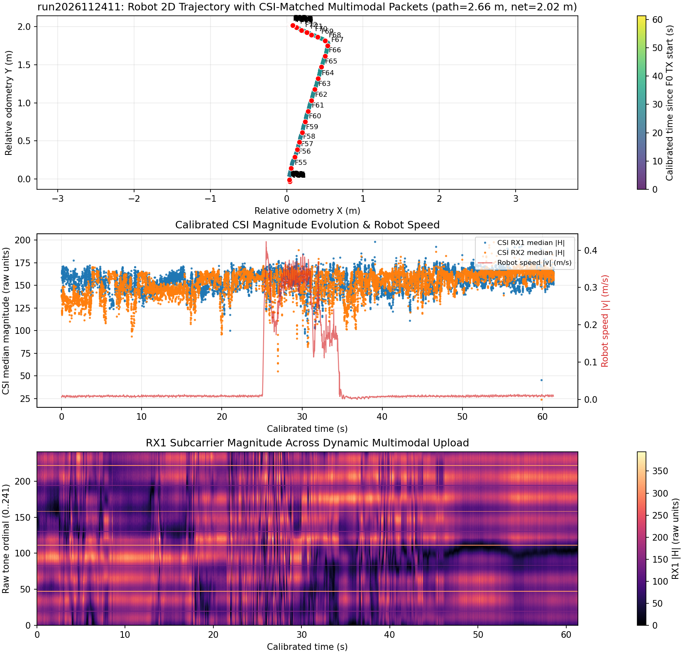

# 机器狗多模态传感器上传与 Wi-Fi CSI 帧级关联平台

文档整理日期：2026 年 11 月 25 日（最新实机验证日期：2026 年 11 月 24 日）。

本项目面向“通感算控一体化平台搭建”，聚焦**获取机器狗在时刻 $t$、空间位置 $(x, y)$ 上传真实视觉（D435i）与激光雷达（MID360）数据时，逐包/逐帧一一对应的无线信道状态信息（CSI）复数矩阵**，并沉淀面向多智能体通信扩展的接口与数据基础。

---

## 一、最终任务与核心技术方案

针对“**此时、此地、此样本 ↔ 真实空口帧 ↔ 复数 CSI**”的严格闭环要求（拒绝时间近邻伪配对），项目已建成完整的软硬件解耦方案与工具链：

1. **三链路解耦采集拓扑**：Jetson Orin NX 经 5 GHz Wi-Fi（Ch 161 / 5805 MHz / 80 MHz）向独立常驻的 Windows 业务接收端上传多模态数据；Ubuntu 工作站通过 RJ45 直连管理口保持全程在线，并用独立 PCIe Intel AX210（PicoScenes 6.5 定制驱动，`mon6`）无源旁路同步抓取原始 802.11 PCAP 与 CSI。
2. **低延迟常驻流水线 + `CSID v2` 协议（[multimodal_stream.py](csi/Linux测试/multimodal_stream.py)）**：
   - D435i 预热 60 帧后跨帧常驻打开，消除原 `pipeline.stop()` 造成的 `1001 ms` 相机-雷达断层，将 Jetson 收到相机 frameset 至收到首个雷达包的间隔压缩至 **`~1–2 ms`**；
   - `CSID v2` 支持 `block_size=1300 B`（UDP `< 1500 B` MTU 无 IP 分片）与 `--stop-file` 帧边界手动停录，并由独立线程以 ~500 Hz 订阅 Go2 `rt/sportmodestate` 为每个发送包附着最新位姿快照（超 `250 ms` 显式标记不可用）。
3. **MID360 100% 比特无损差分压缩（[mid360_codec.py](csi/Linux测试/mid360_codec.py)）**：通过包头列转置 + `int32` XYZ 逐点差分 + ZigZag + 字节平面重排 + `zlib-3`，将每帧 100 ms 完整 360° 扫描（~20,064 点，`289.8 KB`）无损压至 **`~84.9 KB`（29.3%，仅 66 包 @ 1300 B）**，Jetson ARM64 编码仅 `10.5 ms`，解压后 SHA-256 逐字节一致。
4. **四时钟域实时标定与误差界（[clock_sync_probe.py](csi/Linux测试/clock_sync_probe.py)）**：每次采集前后运行 30 次 Jetson ↔ Linux 双向 UDP 四时间戳测距标定跨主机钟差（解决 NTP 漂移），并对 MID360 本地时钟（`+4.17 ppm`，残差 std `0.271 ms`）与 Go2 机器人时间戳（`-7.36 ppm`，残差 std `0.160 ms`）做线性标定。
5. **安全离线解密与异构子载波复数导出（[secure_csi_decode.py](csi/Linux测试/secure_csi_decode.py)、[build_calibrated_dataset.py](csi/Linux测试/build_calibrated_dataset.py)）**：通过临时 Wireshark Profile 传递凭据并退出即覆写销毁（无命令行暴露），执行 `CRC32 + 源分片字节 + PCAP MPDU` 三重逐字节校验，按 PicoScenes 官方 `fromIWLMVM` I/Q 顺序导出 `(M, 2, 242)` 复数矩阵，并对运动回落的 NonHT 52 载波以 `NaN` 与 `csi_num_tones` 显式区分。

---

## 二、全系列实机测试演进与核心指标

详细方案、指标拆解与轨迹热图见完整技术报告：**[动态多模态时空标定与无线帧级 CSI 闭环方案与实测报告](csi/Linux测试/结果/动态多模态时空标定与CSI闭环_20261124.md)**。

| 实验轮次（2026-11-24） | 场景与配置 | 帧数与雷达范围 | 应用端收发与重组 | 精确 CSI 关联（唯一包 / 记录） | 有效 CSI 速率 | 单帧上传耗时 | 关键验证结论 |
|---|---|---|---|---|---|---|---|
| `run04` 预热基线 | 静止，400 B / 15 pps / ×2 | 1 帧 / 5 包碎片 | 168/168 (3/3 样本) | 120/168 (71.4%) / 120 条 | `10.70 条/s` | ~11.2 s | 60 帧预热 RGB 清晰；相机-雷达断层 `1001 ms` |
| `run05` 静止流式 | 静止，1100 B / 50 pps / ×2 | 3 帧 / **完整 360°** | **756/756 (9/9 样本 100%)** | **682/756 (90.21%)** / 702 条 | `44.79 条/s` | ~5.13 s | 相机→雷达压至 `1.0–1.4 ms`，RGB 100%、雷达 98–100% 分片有 CSI |
| `run06` 动态初版 | L 型行走 2.51 m，1100 B / 60 pps / ×1 | 15 帧 / 完整 360° | 28/2221 *(接收端早退)* | 1593/2221 (71.72%) / 1781 条 | `44.82 条/s` | `2.42–2.66 s` | 运动段 CSI CV 放大 10–15×；暴露单帧位移 0.5–1.06 m 瓶颈 |
| `run07–09` 速率拐点 | 静止，1300 B + 差分雷达，120/200/300 pps | 每档 3 帧 / 完整 360° | 每档 255 包发送 | `89.8% / 85.5% / 87.1%` | 最高 **`267.01 条/s`** | 最快 **`0.282 s`** | 300 pps 覆盖未崩塌，最大间隔 `19.95 ms`，有效速率跃升 **6.0×** |
| `run10` 静止高密 | 静止，1300 B + 差分 / 250 pps / ×1 | 55 帧 / 完整 360° | **4836/4836 (165/165 样本 100%)** | **4149/4836 (85.79%)** / 4345 条 | `169.50 条/s` | **`0.348 s`** | `2.15 完整帧/s`，帧内 CSI 间隔中位 `4.00 ms` |
| **`run11` 动态验收** | **L 型行走 2.66 m，250 pps + 手动停录** | **132 帧 / 完整 360°** | **`11,514/11,514`（`396/396` 样本 100% 无损）** | **`8,920/11,514` (77.47%) / `11,025` 条** | **`179.70 条/s`** *(含帧间采雷达)* | **`0.344 s`** *(运动位移 9.86–11.83 cm)* | **132/132 帧均有视觉与雷达 CSI；运动帧内 `1395/1395`（100%）$\le \lambda/2$，含帧间 `98.94%`；校时后 `CSI-Send` 中位 `+0.221 ms`** |

- **直线坐标系标定**：遥控直线前进录波 `8,956` 条（`44,777` 回调 / 0 错误），最大前向位移 `1.076 m`、与 `yaw≈+88.1°` 对齐，实证 `position` 为**右手世界里程计系（单位：米）**，`velocity` 为**机身系**。
- **离线回归测试**：全套 **18 项单元测试**（含 `CSID v1/v2`、`mid360_codec` 比特往返、回环钟差同步与流式重组）全部通过。

---

## 三、核心代码与历史报告导航

### 最新流式标定与动态闭环代码（`csi/Linux测试/`）
- [clock_sync_probe.py](csi/Linux测试/clock_sync_probe.py)：跨主机四时间戳时钟标定与 MID360 / Go2 高频时钟只读标定
- [mid360_codec.py](csi/Linux测试/mid360_codec.py)：MID360 Type-1 点云 100% 比特无损差分压缩编解码器
- [multimodal_stream.py](csi/Linux测试/multimodal_stream.py)：`CSID v2` 低延迟常驻多模态采集/发送与常驻接收重组
- [pose_cal_recorder.py](csi/Linux测试/pose_cal_recorder.py)：Go2 100 Hz 位姿只读录波标定工具
- [secure_csi_decode.py](csi/Linux测试/secure_csi_decode.py)：无命令行凭据暴露的离线 WPA2 解密与逐字节 MPDU 核验
- [build_calibrated_dataset.py](csi/Linux测试/build_calibrated_dataset.py)：统一标定数据集（逐包/逐帧 CSV + 异构载波复数 NPZ）导出器
- [analyze_dynamic_trajectory_csi.py](csi/Linux测试/analyze_dynamic_trajectory_csi.py)：脱敏轨迹统计与 242 子载波热图绘制
- [test_multimodal_stream_offline.py](csi/Linux测试/test_multimodal_stream_offline.py)：离线协议、编解码与标定单元测试

### 阶段性公开报告归档
- **本阶段主报告**：[动态多模态时空标定与 CSI 闭环方案与实测报告](csi/Linux测试/结果/动态多模态时空标定与CSI闭环_20261124.md)
- **前期演进报告**：[逐包位置与传感器 CSI 实验](csi/Linux测试/结果/逐包位置与传感器CSI实验_20261124.md) · [静止多模态帧级关联](csi/Linux测试/结果/静止多模态帧级关联_20261124.md) · [现场网络与时空接口预检](csi/Linux测试/结果/现场网络与时空接口预检_20261124.md) · [背景流量对照与帧特征复核](csi/Linux测试/结果/csi_background_20261110/背景流量对照与帧特征复核.md) · [固定数据单变量对照](csi/Linux测试/结果/csi_rate_control_20261110/固定数据单变量对照.md) · [三轮诊断结果](csi/Linux测试/结果/csi_diagnose_20261110/三轮诊断结果.md) · [静止位置与多模态 CSI 实验](csi/Linux测试/结果/静止位置与多模态CSI实验_20261110.md)
- **阶段汇总与早期归档**：[项目成果与后续计划](csi/Linux测试/结果/项目成果与后续计划_20261107.md) · [实验与项目进度](csi/Linux测试/结果/20261104实验与进度总结.md) · [离线优化与时间分析](csi/Linux测试/结果/20261104离线优化与时间分析.md) · [早期协议与仿真归档](归档/)

---

## 四、当前保留边界与后续深化方向

### 明确科学边界
- **全轮速率与跨帧间距**：`run 2026112411` 全轮有效 CSI 速率为 `179.70 条/s`（低于先前拟定的 `>200 条/s` 目标，主因每帧串行 100 ms 雷达采集空隙）；帧内 100%（`1395/1395`）满足 $\le \lambda/2$，计入帧间空隙为 `98.94%`（`1400/1415`，最大 `4.786 cm`）。
- **传感器测量同步边界**：`1.71 ms` 为 Jetson 收到相机 frameset 至收到首个雷达包的主机接收时间差，非硬件级曝光/激光物理同步精度。
- **定位与相位真值边界**：Go2 位置为腿部里程计/IMU（静止零漂 `0.14–0.38 mm/s`），尚无外部动捕/激光 SLAM 绝对真值；CSI 相位保留官方 I/Q 顺序原始未校准值；CSV 共 `13,619` 行承载 `11,514` 唯一包（保留一对多与缺失）。

### 后续计划
1. **异步双缓冲流水线**：将 100 ms 雷达采样与 UDP 发射异步并行，消除帧间静默空隙，冲刺全轮 `>200 条 CSI/s` 与跨帧 100% 半波长连续性。
2. **绝对位置真值与 CSI 相位校准**：接入激光/视觉 SLAM（如 FAST-LIVO2）或外部真值校核里程计零漂，并对原始 CSI 实施 CFO/SFO/PDD 线性相位校准。
3. **多场景与多智能体扩展**：拓展遮挡/NLOS 对照、多轨迹泛化采集，并与前期智能体通信协议调研（[归档](归档/)）对接，支持多智能体协同通感算控传输。
