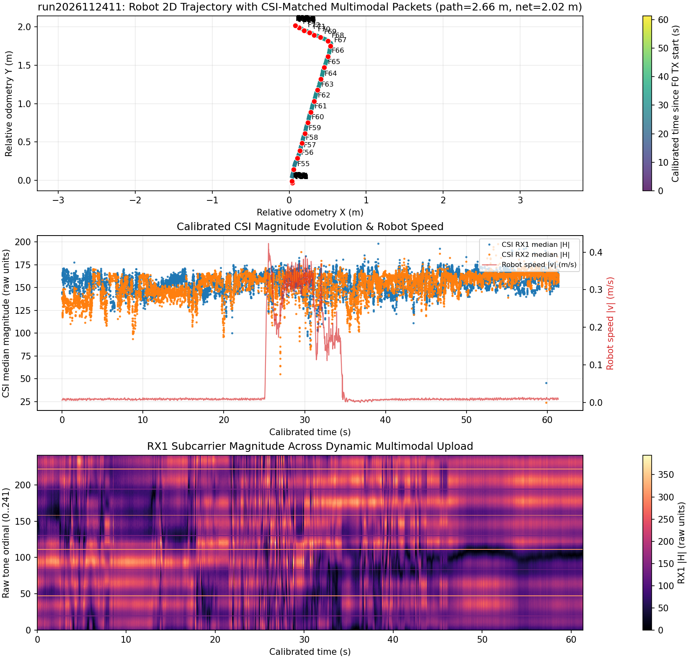

# 动态多模态时空标定与无线帧级 CSI 闭环实验

## 1. 目标与系统升级

面向“获取机器狗在时刻 $t$、位置 $(x, y)$ 上传视觉与激光雷达数据时一一对应的真实无线帧 CSI”的最终目标，本轮重点解决前阶段遗留的四项核心缺口：

1. **多设备时钟域标定与跨主机误差界**：新增 `clock_sync_probe.py`，实现 Jetson 与 Linux 工作站双向 UDP 四时间戳同步测距，并对 MID360 激光雷达本地时钟（`time_type=0`）与 Go2 `rt/sportmodestate` 机器人时间戳进行线性拟合标定。
2. **低延迟流式完整 360° 扫描链路**：新增 `multimodal_stream.py`，引入向后兼容 `CSID` 魔数与 CRC32 的 `CSID v2` 分片格式（`block_size=1100 B`，无 IP 分片）；D435i `pipeline` 跨帧常驻消除原 `pipeline.stop()` 造成的约 `1001 ms` 相机-雷达断层；由原 5 包局部雷达升级为每帧完整 100 ms（10 Hz）360° 扫描（约 20,064–20,160 点，本地留原始无损二进制、空口传无损 zlib 并做双端 SHA-256 核验）。
3. **安全离线解密与多格式复数 CSI 导出**：新增 `secure_csi_decode.py`（通过临时 Wireshark profile 传递凭据并在退出时覆写销毁，避免命令行参数暴露）与 `build_calibrated_dataset.py`（兼容运动中速率回落的异构子载波数，如 VHT 242 与 NonHT 52，以 `NaN` 显式区分不伪造零值），全套 17 项离线单元测试通过。
4. **坐标系/单位核实与受控运动闭环**：通过遥控直线前进标定核实 Go2 位姿单位与轴向，随后开展 15 帧连续“静止 → 移动 → 停稳”动态轨迹多模态 CSI 采集。

---

## 2. 多时钟域与传感器实测标定

- **Jetson ↔ Linux 跨主机钟差**：30/30 双向 UDP 往返（min RTT `4.47–6.00 ms`）。观测到两机 NTP 相对偏移在十余分钟内可变化逾 `16 ms`（如 `+9.32 ms`、`+13.43 ms`、`-13.71 ms`），证实必须在每次采集前后实时标定。
- **MID360 1.0 s 全量流标定**：实收 `2,085` 包 / `200,160` 点（`0` 丢包，精确 `2083.33 Hz` / `200,000 pts/s`）。线性拟合 `jetson_mono vs lidar_ts` 漂移 `+4.17 ppm`，残差标准差 **`0.271 ms`**（`-0.444 ~ +1.677 ms`），可将每个雷达原始点精准映射到 Jetson 统一时间轴。
- **Go2 `rt/sportmodestate` 6.0 s 高频标定**：`2,997` 回调 / `0` 错误（`499.41 Hz`，步长中位 `2.000 ms`）。`jetson_mono vs robot_stamp` 漂移 `-7.36 ppm`，残差标准差 **`0.160 ms`**；`jetson_wall - robot_stamp ≈ 168.26 s`，确认为机器人未同步 NTP 的内部自由运行 Unix 时钟。静止零漂：`x ≈ -0.14 mm/s`、`y ≈ -0.38 mm/s`，站立高度 `z ≈ 0.315 m`（`body_height = 0.320 m`）。
- **直线移动坐标系与单位标定**：遥控机器狗沿车头正前方直线行走（目测 1–2 m），录波 `8,956` 条（`44,777` 回调/0 错误），起始朝向 `yaw ≈ +88.1°`，最大前向水平位移 **`1.076 m`**（净位移 `0.707 m`，总路径 `2.050 m`），主位移方向在世界 `+y` 轴且与 `yaw` 对齐，而 `velocity` 分量集中在 `+vx`（`vy ≈ 0`）。由此确认：`SportModeState.position` 为**右手世界里程计系（单位：米）**，`velocity` 为**机身坐标系**。

---

## 3. 静止 3 帧完整扫描闭环验证（`run 2026112405`）

参数：`frames=3`、`block_size=1100 B`、`50 pps`、`repeat=2`、`lidar_ms=100 ms`、`warmup=60`。

- **同步与完整度**：3 帧相机→雷达起始间隔降至 **`1.380 / 1.001 / 1.124 ms`**（原 `1001.43 ms`）；每帧采集 `20,064–20,160` 雷达点（`99.84–100.32 ms`，`0` 丢包）与清晰 RGB（~22 KB）。
- **端到端无损与精确 CSI 关联**：发送/接收 **`756/756`** 唯一包（`48.17 / 48.19 pps`），**`9/9`** 样本 SHA-256 及接收端雷达无损解压与源二进制逐字节核验全部通过。精确关联 **`682/756` 唯一包（90.21%） / `702` 条 CSI 记录**（有效 `43.52` 唯一包/秒、`44.79` 条 CSI/秒），35 ID 仅 PCAP、39 ID 双路径未恢复。
  - Frame 0：RGB `21/21`（100%）、360° 雷达 `100/100`（100%），包覆盖 `92.06%`；
  - Frame 1：RGB `20/20`（100%）、360° 雷达 `99/100`（99.0%），包覆盖 `90.40%`；
  - Frame 2：RGB `20/20`（100%）、360° 雷达 `100/102`（98.0%），包覆盖 `88.19%`。
- **跨主机时间自检**：采集前后实测 `Linux_wall - Jetson_wall = +11.811 ms ± 4.118 ms`（前 `+13.428 ms`、后 `+10.194 ms`）。校准后全部 702 条 CSI 均落于发送后 **`+0.755 ~ +9.275 ms`（中位 `+1.541 ms`，std `0.377 ms`）**，复数数组 `(702, 2, 242)` 全有限非零。

---

## 4. 动态轨迹 15 帧连续采集闭环（`run 2026112406`）

参数：`frames=15`、`frame_interval=2.5 s`、`block_size=1100 B`、`60 pps`、`repeat=1`（无应用重发）、`lidar_ms=100 ms`、`warmup=60`。机器狗在遥控控制下完成“静止基线（F0–F7）→ L 型行走（F8–F11，总路径 `2.51 m`、净位移 `1.97 m`、峰值速度 `0.774 m/s`）→ 新位置停稳（F12–F14）”约 40 秒连续过程。

| 指标 | 实测结果 |
|---|---|
| 连续帧与传感器规模 | 15 帧清晰 RGB + 15 帧完整 360° MID360 扫描（每帧 `20,064–20,160` 点、`0` 丢包） |
| 相机→雷达起始间隔 | **`0.905 – 2.891 ms`** |
| 发送包与速率 | `2,221` 唯一包（`55.87 pps`，`repeat=1`），Go2 回调 `22,370` 次（`0` 错误），逐包位姿年龄中位 `0.870 ms` |
| 精确 CSI 帧级关联 | **`1,593/2,221` 唯一包（71.72%） / `1,781` 条 CSI 记录**（有效 `40.09` 包/秒、`44.82` 条 CSI/秒），PCAP 恢复 `1,807` 包 |
| CSI 格式与完整性 | `(1781, 2, 242)` 全有限复数：其中 `1,764` 条 VHT 80 MHz（242 载波）、`17` 条运动回落 NonHT（52 载波，显式标注） |
| 跨主机时钟校准 | 前后偏移 `-16.116 ms ± 5.409 ms`（前 `-13.707 ms`、后 `-18.525 ms`），校准后 CSI 相对发送中位 **`+1.063 ms`** |

### 运动与无线信道物理响应

按每帧所有 VHT-80MHz 匹配包的 242 子载波时间变异系数（各子载波 `std/mean` 取中位数）统计：

- **静止起点段（F0–F2）**：单帧位移约 `4.8–5.1 mm`（里程计静止零漂），RX1/RX2 CSI 时间 CV 仅 **`0.025–0.032` / `0.034–0.045`**，子载波热图呈稳定水平条纹；
- **行走运动段（F8–F10）**：单帧传输期间真实移动 `1,061 / 722 / 503 mm`，RX1/RX2 CSI 时间 CV 跃升至 **`0.287–0.389` / `0.293–0.356`**（较静止基线放大约 **10–15 倍**），子载波幅度出现显著频率选择性衰落演化；
- **新位置停稳段（F12–F13）**：位移回落至 `4.7 mm`，RX1 CSI CV 回落至 `0.199 → 0.084`，且 242 子载波呈现与起点显著不同的新空间多径指纹（中位幅度由起点 ~161 移至 ~142–147）。

---

## 5. 无损雷达差分压缩、速率拐点实测与 250 pps 动态验收（`run 2026112407–11`）

针对 `run 2026112406`（60 pps）单帧传输耗时约 `2.5 s`（运动期间位移 `0.50–1.06 m`）且 Windows 接收端提前退出的不足，本阶段进一步完成三项关键升级：

1. **MID360 100% 比特无损差分压缩（`mid360_codec.py`）**：包头列转置 + `int32` XYZ 逐点差分 + ZigZag + 字节平面重排 + `zlib-3`。Jetson ARM64 编码仅 `10.5 ms`，单帧 100 ms 完整 360° 扫描由 `289,800 B`（原普通 `zlib` `129,362 B`）压缩至 **`84,910 B`（`29.3%`，`block=1300 B` 仅 66 包）**，解压后与原始二进制 SHA-256 逐字节一致。
2. **120 / 200 / 300 pps 速率拐点实测（静止，`block=1300 B`，`repeat=1`）**：
   - `120 pps`（`run07`）：匹配 `89.80%`（`109.14 条/s`），整帧 `0.706 s`，最大间隔 `24.99 ms`；
   - `200 pps`（`run08`）：匹配 `85.49%`（`172.36 条/s`），整帧 `0.422 s`，最大间隔 `14.99 ms`；
   - `300 pps`（`run09`）：匹配 `87.06%`（**`267.01 条/s`**），整帧 **`0.282 s`**，间隔中位 `3.33 ms` / P95 `6.66 ms` / 最大 `19.95 ms`。
3. **250 pps 手动停录高密动态验收（`run 2026112411`，独立常驻 Windows 接收端）**：
   - 连续采集 **`132` 帧（`61.35 s`，`2.15 完整帧/秒`）**，包含完整 21 帧 L 型行走过程（`F53–F73`，路径 **`2.661 m`**、净位移 **`2.017 m`**、峰值速度 `0.423 m/s`）。
   - **应用端 100% 零丢包重组**：`11,514 / 11,514` 唯一包（`0` 丢包、`0` 无效包），**`396 / 396`** 样本（132 RGB + 132 完整 360° 雷达 + 132 元数据）全部通过 SHA-256 及比特级无损雷达解压校验。
   - **单帧上传时间与运动段 CSI 空间间距**：单帧传输耗时仅 **`275.8–356.5 ms`（中位 `344.1 ms`）**。Jetson 从收到相机 frameset 到收到首个雷达包的间隔为 `0.82–4.60 ms`（中位 `1.71 ms`）；21 帧运动段内单帧上传期间位移压缩至**中位 `9.86 cm`、最大 `11.83 cm`**（较此前 `106 cm` 缩小 ~9×）。精确匹配 **`8,920 / 11,514` 唯一包（77.47%） / `11,025` 条 CSI 记录**。含每帧 100 ms 雷达采样的全轮有效速率为 **`145.39 包/s`、`179.70 条 CSI/s`**。复数矩阵为 `(11025, 2, 242)`。10,930 条 VHT-242 和 95 条 NonHT-52 的有效载波均有限，NonHT 行其余位置以 NaN 填充。运动段帧内相邻 CSI 间距中位 **`0.107 cm`**、P95 `0.342 cm`、最大 **`2.350 cm`（`100.00%` $\le \lambda/2 = 2.58\text{ cm}$）**，计入帧间空隙后，`98.94%` 的间距不超过半波长，最大间距为 `4.786 cm`。
   - **跨主机校时**：采集前后偏移 `-20.200 ms ± 4.148 ms`（前 `-21.596 ms`、后 `-18.804 ms`），校准后 11,025 条 CSI 相对发送时间的中位差为 **`+0.221 ms`**，校时不确定度约为 `4.148 ms`。

本轮 132 帧均有 RGB 和雷达数据的 CSI 关联。全轮速率为 `179.70 条 CSI/s`，先前拟定的 `>200 条 CSI/s` 目标在本轮未达成。运动段同一帧内 `1395/1395` 个相邻 CSI 间距不超过半波长，计入帧间间隔后为 `1400/1415`。空间间距由每条 CSI 所对应应用包的 Go2 位置快照估算。

*(注：在 `run 2026112410` 中另完成 55 帧 250 pps 静止高密端到端对照：`4,836/4,836` 包、`165/165` 样本 100% 重组，精确匹配 `4,149` 包（85.79%）/`4,345` 条 CSI（`169.50 条/s`）。)*

---

## 6. 边界说明与设备恢复

1. **端到端与物理边界**：`run 2026112411` 已在同一轮运动中同时验证应用端 100% 零丢包重组（396/396 样本）、亚秒级整帧传输（`0.344 s` / 位移 `< 12 cm`）与观测到的运动段 CSI 帧内半波长间距。相机与雷达的 `1.71 ms` 是 Jetson 接收时间差，两者物理测量时刻的独立同步精度仍待验证。Go2 位置来自腿部里程计/IMU（单位已实证为米，静止零漂约 `0.14–0.38 mm/s`），尚无外部动捕或激光 SLAM 绝对真值；CSI 相位保留官方 I/Q 顺序原始未校准值（待后续 CFO/SFO/PDD 校准）。
2. **收尾核验**：全套 18 项离线单元测试通过；全部轮次后 Linux AX210 均已移除 `mon6`、恢复 `managed=yes` / `power_save=on` 并重连原热点；Jetson 相机服务恢复 `active` 且 `/status` 返回 `HTTP 200`（未修改配置或 `daemon-reload`）。所有原始图像、点云、绝对坐标、无线抓包、CSI 数组及密钥仅保存本地。
