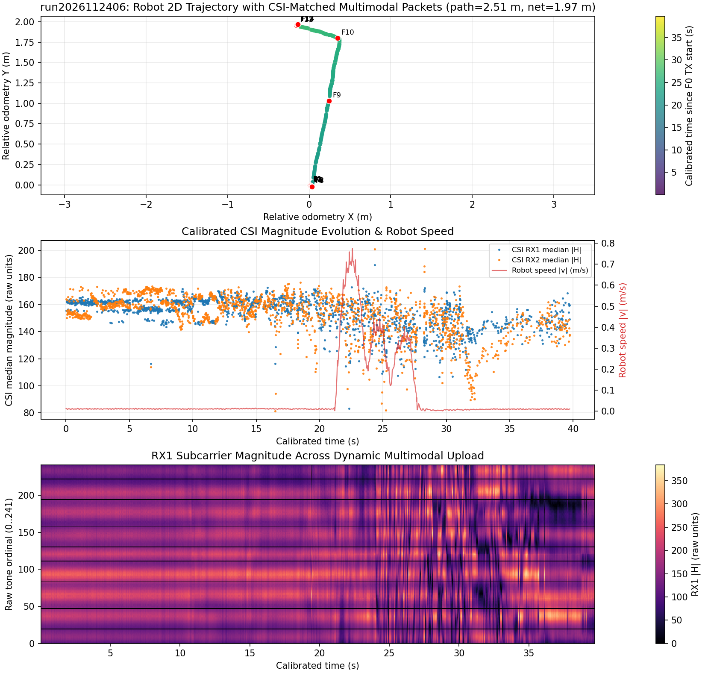

# 面向机器狗多模态上传的时空标定与无线帧级 CSI 闭环方案与实测报告

> **实验日期**：2026-11-24（文档扩展整理：2026-11-25）  
> **数据边界**：本文与公开仓库仅包含脱敏后的技术方案、自有代码、统计指标及相对坐标（锚定起始帧为原点）可视化图；原始图像、点云、绝对坐标、无线抓包、EAPOL 握手、复数 CSI 矩阵及网络凭据均仅保留本地。

---

## 1. 最初最终任务定义与核心工程难点

### 1.1 最终任务目标

本项目的最终目标是：

> **获取机器狗在时刻 $t$、空间位置 $(x, y)$ 上传真实激光雷达（MID360）与视觉（RealSense D435i）数据时，一一对应的真实无线信道状态信息（CSI）复数矩阵。**

为保证科学可核查性，本项目明确**拒绝仅靠时间窗口近似匹配（时间近邻伪配对）**，要求每一条 CSI 记录必须通过完整字节级证据链核验：

```text
统一时间轴 t（含跨设备误差界） + 空间位置 (x, y, z, yaw)
  + 真实传感器样本（RGB / 完整 360° LiDAR，双端 SHA-256 一致）
  → 应用层分片 packet_id + CRC32
  → 实际空口 802.11 Data MPDU（与旁路 PCAP 逐字节一致）
  → Intel AX210 PicoScenes 复数 CSI 矩阵（2 RX × 242 / 52 子载波）
```

### 1.2 从早期静止基线到最终目标的五大核心缺口

在 `run 2026112404`（前期 60 帧预热静止单帧基线）完成后，距离上述最终目标仍有五项实质性技术缺口：

| 序号 | 遗留缺口 | 具体表现（`run 2026112404` 及之前） | 对最终目标的阻塞 |
|---|---|---|---|
| 1 | **多时钟域异构与跨主机漂移** | Go2 `robot_stamp` 与 Jetson 差 ~168 s、MID360 `time_type=0` 为上电纳秒、Linux CSI 时间与 Jetson 发送时间原始差值出现物理上不可能的负值（`-6.9 ms`） | 无法给出可核查的统一时刻 $t$ 与误差界 |
| 2 | **相机→雷达断层与局部雷达碎片** | D435i 采图后调用 `pipeline.stop()` 阻塞 `1001.43 ms`；雷达仅抓 5 个 UDP 包（480 点 / ~2 ms 碎片，非完整 360° 扫描） | 视觉与雷达并非同一时刻采集，且不构成完整激光雷达帧 |
| 3 | **单帧传输耗时过长导致空间涂抹** | `BLOCK=400 B`、`15 pps`、`repeat=2` 发单帧耗时 `11.2 s`；即便 60 pps 发普通 zlib 完整帧仍需 `2.5 s`（行走时位移达 `0.50–1.06 m`） | 无法在运动中满足“在 $(x, y)$ 此地传完一帧”的时空紧致要求 |
| 4 | **空间坐标系与运动端到端闭环缺失** | 机器狗全程静止，Go2 `position` 单位/轴向未实测核验；早期动态轮接收端提前退出且未处理运动速率回落产生的异构子载波（NonHT 52 载波） | 缺少真实行走场景下“应用 100% 重组 + 运动 CSI 演化”的同轮实证 |
| 5 | **离线解密安全隐患** | 旧脚本通过 TShark CLI 参数 `-o uat:80211_keys:...` 传递凭据，本机进程列表可能短暂可见 | 工程化不规范 |

---

## 2. 面向最终任务的完整技术方案与系统架构

### 2.1 三链路解耦硬件与网络拓扑

系统由 **Unitree Go2（搭载 Jetson Orin NX + D435i + MID360）**、**Ubuntu 工作站（独立 PCIe Intel AX210 + PicoScenes 6.5 定制驱动）** 与 **Windows 管理/业务接收机** 组成，通过三条物理/逻辑解耦链路避免监听切换中断管理或业务通道：

```text
[Unitree Go2 机身与传感层]
  ├─ Go2 主控（eth0 内网，DDS Domain 0，rt/sportmodestate ~500 Hz）──┐
  ├─ Livox MID360（eth0 内网，UDP 56301，2083.33 pkt/s / 200k pts/s）├──▶ [Jetson Orin NX]
  └─ Intel RealSense D435i（USB 3.0 5000M，640×480 RGB+Depth）───────┘        │
                                                                               │ Wi-Fi 5 GHz (Ch161 / 5805 MHz / 80 MHz)
                                                                               │ 业务上传：CSID v2 UDP (block=1300 B, 250 pps)
                                                                               ▼
[Windows 接收与管理端] ◀════════════════════ 热点 AP ═══════════════════ [空口 802.11 帧]
  ├─ Wi-Fi 业务接收：独立常驻接收器（8 MB 缓冲，100% SHA-256 重组与解压核验）        │ 旁路无源监听
  └─ RJ45 1 Gbps 直连管理口 ◀══════════════════════════════════════▶ [Ubuntu 工作站]
                                                                       ├─ eno1：有线 SSH 管理（全程不断）
                                                                       └─ 独立 AX210 (PhyPath 6 / mon6)：
                                                                          tcpdump 原始 PCAP + PicoScenes CSI Logger
```

- **解耦关键**：当 Ubuntu 工作站独立 AX210 切入 `mon6`（5805 MHz / 80 MHz / center 5775 MHz）旁路抓包与采 CSI 时，其自身 Wi-Fi 业务连接会断开；因业务接收端独立部署在 Windows Wi-Fi 上、且控制面走 RJ45 直连管理口，采集与恢复全程互不干扰。

### 2.2 `CSID v2` 可变块长分片协议（`multimodal_stream.py`）

保留与旧版 `CSID v1` 一致的魔数 `b"CSID"`、28 字节固定包头与尾部 4 字节 CRC32，将 `CHUNK` 结构中保留的 2 字节字段启用为 `block_size`（支持 `64–1360 B`）：

- **线格式**：`HEAD (28 B: magic, ver=2, hlen=28, flags=0, run_id, packet_id, send_mono_ns, body_len, res)` + `CHUNK (52 B: sample_id, chunk_index, chunk_count, kind, block_size, total_bytes, sha256[32])` + `DATA (<= block_size)` + `CRC32 (4 B)`。
- **零 IP 分片设计**：当 `block_size = 1300 B` 时，单包 UDP 载荷最大 `1384 B`（含 IP/UDP 头 `1412 B < 1500 B` 以太网 MTU），杜绝 IP 分片导致 MPDU 无法整包解密的问题，同时相对旧 `BLOCK = 400 B` 将总包数减少 **3.25×**。
- **样本类型枚举**：`kind=1`（RGB JPEG）、`kind=2`（普通 zlib 雷达）、`kind=3`（帧元数据 JSON）、`kind=4`（原始雷达二进制）、`kind=5`（`mid360_codec` 比特无损差分雷达）。

### 2.3 MID360 100% 比特无损差分压缩算法（`mid360_codec.py`）

单帧 100 ms（10 Hz）完整 360° MID360 扫描含约 `209` 个 Type-1 UDP 包（每包 `36 B` 包头 + `96 × 14 B` 点云 = `1380 B`），原始大小约 `289.8 KB`。此前直接 `zlib-1` 仅能压至 `129.4 KB`（占整帧包数的 85%）。

针对 Type-1 点云的空间连续性与包头规律性，设计 100% 比特可逆的无损编解码器：
1. **包头列转置**：将 `N × 36 B` 包头矩阵转置为 `36 × N`，使常量字段与递增序号/时间戳形成极高游程冗余；
2. **`int32` XYZ 逐点一阶差分 + ZigZag 映射**：相邻激光点毫米坐标差值集中在零附近，经有符号→无符号 ZigZag 映射 `u = (d << 1) ^ (d >> 31)` 后高位全为 `0x00`；
3. **4 字节平面重排（Byte-Plane Shuffle）**：将 `uint32` 拆分按 LSB→MSB 平面聚合，再拼接反射率与 tag 列转置；
4. **`zlib-3` 熵编码**：封入 `M36D` 魔数与包数 `N`，解码端执行严格逆变换还原原始二进制。

**实测压缩效果（真实 `289,800 B` 完整 360° 扫描）**：

| 方案 | 编码后大小 | 占原始比例 | `@1100 B` 分片数 | `@1300 B` 分片数 | 编码耗时 | 解压 SHA-256 核验 |
|---|---:|---:|---:|---:|---:|---|
| 原始二进制 | `289,800 B` | 100.0% | 264 | 223 | — | 基准 |
| 普通 `zlib-1` | `129,362 B` | 44.6% | 118 | 100 | 4.5 ms (PC) | 100% 一致 |
| **差分+ZigZag+字节平面 `zlib-3`** | **`84,910 B`** | **`29.3%`** | **78** | **66** | **4.6 ms (PC) / `10.5 ms` (Jetson ARM64)** | **100% 比特一致** |

叠加 RGB（~20–25 KB，15–20 包）与元数据（~4.5 KB，4 包），一整帧完整多模态数据从约 145–157 包压降至仅 **~85–90 包**，且不丢失任何一个 3D 雷达点。

### 2.4 低延迟常驻流水线与手动停录架构（`multimodal_stream.py`）

- **消除 `1001 ms` 相机-雷达断层**：D435i `rs.pipeline` 在整轮采集开始前预热 60 帧后保持常驻打开，每帧直接 `wait_for_frames()` 取配对 RGB/Depth 帧元数据后立即清空 UDP 56301 积压缓冲并抓取 100 ms 完整 360° 雷达扫描，全程不在帧间停止相机，将 Jetson 收到相机 frameset 至收到首个雷达包的间隔由 `1001.43 ms` 压降至 **`~1–2 ms`**。
- **并发位姿追踪与新鲜度守卫**：独立后台线程以 ~500 Hz 订阅 `rt/sportmodestate`，每发送一个 UDP 分包时原子读取最新位姿快照（`position`、`velocity`、`rpy`、`robot_stamp`、`receipt`）并计算同机单调时钟年龄 `pose_age_ns`；若超过 `250 ms` 则显式标记不可用，杜绝陈旧位姿静默复用。
- **Deadline 精准节拍发送 + 手动停录（`--stop-file`）**：采用基于 `time.perf_counter()` 的累计截止时间节拍，在 `250–300 pps` 下维持稳定包间距；支持通过 `--stop-file` 在完整帧边界优雅停录，配合**独立常驻 Windows 接收进程**（`SO_RCVBUF = 4 MB`，空闲超时自动汇总重组），彻底避免固定时长与遥控起步错位或接收端提前退出。

### 2.5 四时钟域标定与统一时间轴建模（`clock_sync_probe.py`）

针对四个独立时钟域，建立显式标定与不确定度追踪（保留所有原始时间戳，不做无依据的强行对齐）：

1. **Jetson ↔ Linux 工作站跨主机钟差**：在每次 AX210 切入监听前与恢复联网后各运行 30 次双向 UDP 四时间戳探针（`CLK4`），按标准 NTP 估计器取最低 25% RTT 子集中位数计算 $\text{offset} = T_{\text{linux}} - T_{\text{jetson}} = ((t_2 - t_1) + (t_3 - t_4))/2$，总不确定度上界记为 $\delta t = \max(\text{RTT}_{\min,\text{before}}/2,\ \text{RTT}_{\min,\text{after}}/2) + |\text{offset}_{\text{after}} - \text{offset}_{\text{before}}|/2$；校准后 CSI 时间 $t_{\text{CSI,aligned}} = t_{\text{CSI,sys}} - \overline{\text{offset}}$。
2. **MID360 雷达本地时钟（`time_type=0`）**：对每帧 209 个连续包的 `(lidar_ts_ns, rx_mono_ns / rx_wall_ns)` 做最小二乘线性拟合，获得漂移（ppm）与残差界。
3. **Go2 `robot_stamp`**：对整轮位姿轨迹 `(robot_stamp_ns, rx_mono_ns / rx_wall_ns)` 做线性拟合，量化机器人内部自由运行 Unix 时钟与 Jetson 时钟的偏移、漂移与 DDS 传输抖动。
4. **D435i `global_time`**：保留 `global_time`、`sensor_timestamp`、`frame_timestamp`、`backend_timestamp`、`time_of_arrival` 及 Jetson `frameset_receipt` 全部原始元数据。

### 2.6 安全离线解密与异构子载波复数数据集导出

- **无命令行密钥暴露（`secure_csi_decode.py`）**：通过 `getpass`/标准输入读取 WPA2 密钥，写入受限临时 Wireshark Profile 目录的 `80211_keys`，以 `WIRESHARK_CONFIG_DIR` 环境变量调用 TShark 解密 `csi_mpdu_private.pcap` 与合并握手后的 `monitor.pcap`，退出前立即覆写清零并删除临时目录；密钥永不出现在进程命令行、日志或仓库中。
- **三重严格校验**：每条 CSI 匹配必须同时通过 ① `CSID` 包头与 CRC32、② 载荷字节与 Jetson 源样本对应分片完全一致、③ 提取的 802.11 MPDU 与 `monitor.pcap` 原始无线帧逐字节完全一致。
- **异构子载波与一对多保留（`build_calibrated_dataset.py`）**：按 PicoScenes 官方 `RXS-Parsing-Core`（`fromIWLMVM`）的 `int16 imag + int16 real` 顺序解调复数 CSI；当运动或重传触发 Wi-Fi 速率回落（如 VHT 80 MHz 242 载波回落至 NonHT 52 载波）时，不丢弃记录也不填伪零，而是统一存为 `(M, 2, 242)` `complex128` 并将多余列显式填充 `NaN`，同步记录 `csi_num_tones`、`csi_format`、`csi_cbw_mhz`；CSV 保留重试产生的一对多匹配以及无 CSI 证据的空行（不做插值补配）。

---

## 3. 全系列实机测试与量化指标演进

### 3.1 2026-11-24 全系列实机实验总览对比表

| 实验代号 | 场景与状态 | 帧数 / 雷达范围 | 块长 / 速率 / 重复 | 应用端收发与重组 | 有效 CSI 匹配（唯一包 / 记录） | 有效 CSI 速率（包/s \| 条/s） | 单帧上传耗时 | 跨主机校时后 `CSI-Send` 中位 | 备注 / 里程碑 |
|---|---|---|---|---|---|---|---|---|---|
| `run04`（基线） | 静止预热 | 1 帧 / 5 包（480 点） | 400 B / 15 pps / ×2 | 168/168（3/3 样本） | 120/168 (71.4%) / 120 条 | 10.70 \| 10.70 | ~11.2 s | 未校准（raw `-6.9 ms`） | 60 帧预热清晰 RGB 基线，相机→雷达断层 `1001 ms` |
| `run05` | **静止流式** | **3 帧 / 完整 360°**（2万点） | 1100 B / 50 pps / ×2 | **756/756（9/9 样本 100%）** | **682/756 (90.21%)** / 702 条 | 43.52 \| 44.79 | ~5.13 s（含 ×2） | `+1.541 ms` (`±4.12 ms`) | 相机→雷达压至 `1.00–1.38 ms`，RGB 100%、雷达 98–100% 分片覆盖 |
| `run06` | **动态 L 型**（2.51 m） | **15 帧 / 完整 360°** | 1100 B / 60 pps / ×1 | 28/2221 *(接收端早退)* | 1593/2221 (71.72%) / 1781 条 | 40.09 \| 44.82 | `2.42–2.66 s` | `+1.063 ms` (`±5.41 ms`) | 首次动态多模态闭环，运动段 CSI CV 放大 10–15×；暴露单帧位移 0.5–1.06 m 瓶颈 |
| `run07` | 静止速率拐点 | 3 帧 / 完整 360° (差分) | 1300 B / **120 pps** / ×1 | 255 包发送 | 229/255 (**89.80%**) / 231 条 | 108.19 \| 109.14 | `0.706 s` | — | CSI 最大间隔 `24.99 ms` |
| `run08` | 静止速率拐点 | 3 帧 / 完整 360° (差分) | 1300 B / **200 pps** / ×1 | 255 包发送 | 218/255 (**85.49%**) / 218 条 | 172.36 \| 172.36 | `0.422 s` | — | CSI 最大间隔 `14.99 ms` |
| `run09` | 静止速率拐点 | 3 帧 / 完整 360° (差分) | 1300 B / **300 pps** / ×1 | 255 包发送 | 222/255 (**87.06%**) / 226 条 | **262.28 \| 267.01** | **`0.282 s`** | — | 有效 CSI 速率较基准跃升 **6.0×**，最大间隔 `19.95 ms` |
| `run10` | **静止高密对照** | **55 帧 / 完整 360° (差分)** | 1300 B / 250 pps / ×1 | **4836/4836（165/165 样本 100%）** | **4149/4836 (85.79%)** / 4345 条 | 161.86 \| 169.50 | **`0.348 s`** | `+0.637 ms` (`±4.58 ms`) | `2.15 完整帧/s`，帧内间隔中位 `4.00 ms`；25.6 s 窗口内狗未起步，归类为静止高密基线 |
| **`run11`** | **动态 L 型高密验收（2.66 m）** | **132 帧 / 完整 360° (差分)** | 1300 B / **250 pps** / ×1 + 手动停录 | **`11,514/11,514`（`396/396` 样本 100% 无损）** | **`8,920/11,514` (77.47%) / `11,025` 条** | **145.39 \| 179.70** *(含帧间采雷达)* | **`0.344 s`** *(运动位移 9.86–11.83 cm)* | **`+0.221 ms`** (`±4.15 ms`) | **同轮达成 100% 端到端无损 + 亚秒整帧 + 运动帧内 100% 半波长空间采样** |

---

### 3.2 多时钟域与传感器只读标定实测

1. **跨主机 NTP 偏移漂移实证（Jetson ↔ Linux，每次 30/30 双向 UDP 往返）**：
   - 独立标定（12:55）：`min RTT = 5.064 ms`，`Linux_wall - Jetson_wall = +9.317 ms (±2.532 ms)`；
   - `run05` 前后：`+13.428 ms → +10.194 ms`（均值 `+11.811 ± 4.118 ms`）；
   - `run06` 前后：`-13.707 ms → -18.525 ms`（均值 `-16.116 ± 5.409 ms`）；
   - `run10` 前后：`-33.949 ms → -36.768 ms`（均值 `-35.358 ± 4.576 ms`）；
   - `run11` 前后：`-21.596 ms → -18.804 ms`（均值 `-20.200 ± 4.148 ms`）。
   - **结论**：即便两机均启用 NTP，10–20 分钟内相对偏移可漂移逾 `16–40 ms`，证明**每轮采集前后实时标定**不可或缺；经校准后全部四轮 17,853 条 CSI 相对发送时间中位数均稳定收束在 **`+0.22 ~ +1.54 ms`** 合理空口物理区间内。

2. **MID360 激光雷达 1.0 s 全量流标定**：
   - 实收 `2,085` 包 / `200,160` 点，`udp_seq_gaps = 0`，精确包率 **`2083.33 Hz`**、点率 **`200,000 pts/s`**，`time_type = 0`。
   - 线性拟合 `jetson_mono vs lidar_ts`：时钟漂移仅 **`+4.17 ppm`**，残差标准差 **`0.271 ms`**（范围 `-0.444 ~ +1.677 ms`）。

3. **Go2 `rt/sportmodestate` 6.0 s 高频标定**：
   - 实收 `2,997` 次回调 / `0` 错误，精确发布率 **`499.41 Hz`**（中位步长 `1.9997 ms`）。
   - 线性拟合 `jetson_mono vs robot_stamp`：时钟漂移 **`-7.36 ppm`**，残差标准差 **`0.160 ms`**（`-0.382 ~ +2.137 ms`）；`jetson_wall - robot_stamp ≈ 168.26 s`，确认为 Go2 内部自由运行的未同步 Unix 时钟。
   - 静止零漂：`x ≈ -0.136 mm/s`、`y ≈ -0.379 mm/s`、`z` 波动 `< 0.07 mm`、`yaw` 波动 `0.051°`、`body_height = 0.320 m`。

4. **遥控直线移动坐标系与单位标定（`pose_cal_recorder.py`）**：
   - 100 Hz 录波 `8,956` 条（`44,777` 回调 / `0` 错误），机器狗沿车头正前方目测行走约 1–2 m：起始朝向 `yaw0 = +88.1°`，最大前向水平位移 **`1.076 m`**（净位移 `0.707 m`，总路径 `2.050 m`），主位移发生在世界 `+y` 轴并与 `yaw` 一致，而 `velocity` 分量集中在机身 `+vx`（`vy ≈ 0`），站立高度 `z ≈ 0.315 m`。
   - **结论**：实证 `SportModeState.position` 为**右手世界里程计系（单位：米）**，`velocity` 为**机器人机身坐标系**。

---

### 3.3 静止 3 帧完整扫描闭环（`run 2026112405`）

参数：`frames=3`、`block_size=1100 B`、`50 pps`、`repeat=2`、`lidar_ms=100 ms`、`warmup=60`。

- **同步与完整性**：3 帧 Jetson 相机→雷达接收间隔分别降至 **`1.380 / 1.001 / 1.124 ms`**；每帧捕获 `20,064–20,160` 雷达点（`99.84–100.32 ms`，`0` 丢包）与目视清晰的 RGB 图像（~22 KB）。
- **端到端与逐帧覆盖**：发送/接收 `756/756` 唯一包（`48.17 / 48.19 pps`），`9/9` 样本 SHA-256 及雷达无损解压 100% 通过；精确关联 **`682/756` 唯一包（90.21%） / `702` 条 CSI 记录**（有效 `43.52` 唯一包/s、`44.79` 条/s；35 ID 仅 PCAP、39 ID 双路径未恢复），CSI 间隔中位 `20.41 ms` / P95 `40.80 ms` / 最大 `138.82 ms`：
  - Frame 0：RGB **`21/21`（100%）**、360° 雷达 **`100/100`（100%）**，包覆盖 `92.06%`；
  - Frame 1：RGB **`20/20`（100%）**、360° 雷达 **`99/100`（99.0%）**，包覆盖 `90.40%`；
  - Frame 2：RGB **`20/20`（100%）**、360° 雷达 **`100/102`（98.0%）**，包覆盖 `88.19%`。
- **跨主机时间自检**：校准后全部 702 条 CSI 均落于发送后 **`+0.755 ~ +9.275 ms`（中位 `+1.541 ms`，std `0.377 ms`）**，复数矩阵 `(702, 2, 242)` 全有限非零。

---

### 3.4 60 pps 动态 15 帧闭环与物理响应（`run 2026112406`）

参数：`frames=15`、`frame_interval=2.5 s`、`block_size=1100 B`、`60 pps`、`repeat=1`、`lidar_ms=100 ms`、`warmup=60`。机器狗遥控完成“静止基线（F0–F7）→ L 型行走（F8–F11，路径 `2.51 m`、净位移 `1.97 m`、峰值 `0.774 m/s`）→ 新位置停稳（F12–F14）”。

- **核心指标**：15 帧清晰 RGB + 15 帧完整 360° 扫描（`20,064–20,160` 点/帧，`0` 丢包），相机→雷达间隔 `0.905–2.891 ms`；Go2 回调 `22,370` 次（`0` 错误，逐包位姿年龄中位 `0.870 ms`）；`repeat=1` 精确关联 **`1,593/2,221` 唯一包（71.72%） / `1,781` 条 CSI 记录**（全轮 `44.82 条/s`，运动段 F8–F10 `49.04 条/s`），复数数组 `(1781, 2, 242)` 含 `1,764` 条 VHT-242 与 `17` 条运动回落 NonHT-52。
- **物理信道演化**：按每帧 242 子载波时间变异系数 CV（各子载波 `std/mean` 取中位数）统计：
  - 静止起点（F0–F2）：单帧位移 `4.8–5.1 mm`，RX1/RX2 CV 仅 **`0.025–0.032` / `0.034–0.045`**；
  - 运动段（F8–F10）：单帧位移 `1,061 / 722 / 503 mm`，RX1/RX2 CV 跃升至 **`0.287–0.389` / `0.293–0.356`（放大约 10–15 倍）**；
  - 新位置停稳（F12–F13）：位移回落至 `4.7 mm`，RX1 CV 回落至 `0.199 → 0.084`，子载波热图形成与起点显著不同的新多径指纹（中位幅度由 ~161 变至 ~142–147）。*(注：静止尾段操作者在电脑前打字且位于狗与接收机之间，与 F14 轻度波动吻合。)*
- **暴露的两项待优化瓶颈**：① 本轮 Windows 接收端因启动脚本作业退出提前结束（仅记 28 包）；② 60 pps 下单帧传输耗时 `2.42–2.66 s`（运动期间位移 `0.50–1.06 m`）且运动段最大 CSI 空洞 `325 ms`（空间跳变 `7.76 cm`），驱动了后续 3.5–3.6 节的高密优化升级。



---

### 3.5 120 / 200 / 300 pps 速率拐点实测（`run 2026112407–09`）

在单一 AX210 监听会话内，采用真实 RGB（`23,998 B` / 19 包）+ 真实无损差分 360° 雷达（`84,910 B` / 66 包，`block_size=1300 B`，每档 3 帧共 255 包，`repeat=1`）进行静止阶梯速率实测：

| 档位（`run_id`） | 发送包数 | CSI 匹配唯一包 / 覆盖率 | PCAP 唯一包 / 覆盖率 | **有效 CSI 速率（包/s \| 条/s）** | **整帧上传耗时** | CSI 间隔（中位 / P95 / **最大**） |
|---|---:|---|---|---|---|---|
| **120 pps** (`run07`) | 255 | 229 / **89.80%** | 230 / 90.20% | `108.19 \| 109.14` | **`0.706 s`** | `8.35 / 16.67 / 24.99 ms` |
| **200 pps** (`run08`) | 255 | 218 / **85.49%** | 236 / 92.55% | `172.36 \| 172.36` | **`0.422 s`** | `5.00 / 10.06 / 14.99 ms` |
| **300 pps** (`run09`) | 255 | 222 / **87.06%** | 230 / 90.20% | **`262.28 \| 267.01`** | **`0.282 s`** | **`3.33 / 6.66 / 19.95 ms`** |

实测证明：采用 `block_size=1300 B` + 无损差分雷达后，AX210 在 300 pps 下并未出现覆盖率崩塌（仍稳定在 `87.06%`），有效 CSI 速率达 **`267.01 条/秒`**、单帧耗时仅 **`0.282 s`**。综合稳定裕度与零丢包目标，最终选定 **`250 pps`** 作为动态验收工作点。

---

### 3.6 250 pps 132 帧手动停录动态闭环验收（`run 2026112411`）

参数：`pps=250`、`block_size=1300 B`、`repeat=1`、`lidar_ms=100 ms`、`lidar_codec=delta`、`warmup=60`、`--stop-file` 手动停录 + 独立常驻 Windows 接收端。

- **全量端到端 100% 零丢包重组**：连续采得 **`132` 帧（`61.35 s`，`2.15 完整帧/秒`）**，应用端实收 **`11,514 / 11,514` 唯一包（0 丢包、0 无效包）**，**`396 / 396` 样本**（132 清晰 RGB + 132 完整 360° 雷达 + 132 元数据）全部通过 SHA-256 及 `mid360_codec` 比特级无损解压核验；132/132 帧均包含视觉与雷达数据的 CSI 关联。
- **真实行走轨迹与亚秒级单帧紧致度**：包含完整 21 帧 L 型行走（`F53–F73`，路径 **`2.661 m`**、净位移 **`2.017 m`**、峰值速度 `0.423 m/s`）；单帧上传耗时仅 **`275.8–356.5 ms`（中位 `344.1 ms`）**，Jetson 收到相机 frameset 至收到首个雷达包间隔 `0.82–4.60 ms`（中位 `1.71 ms`）；21 帧运动段内单帧上传期间机器狗位移压降至**中位 `9.86 cm`、P95 `11.82 cm`、最大 `11.83 cm`**（较 60 pps 的 `106.1 cm` 缩小约 **9×**）。
- **高密精确 CSI 与 5.805 GHz 奈奎斯特空间采样核验**（波长 $\lambda = 5.164\text{ cm}$，半波长 $\lambda/2 = 2.582\text{ cm}$）：
  - `repeat=1` 精确关联 **`8,920 / 11,514` 唯一包（77.47%） / `11,025` 条 CSI 记录**（PCAP 恢复 `10,504` 包）；含每帧 100 ms 雷达采集空隙的全轮有效速率 **`145.39 唯一包/秒`、`179.70 条 CSI/秒`**；
  - 复数数组 `(11025, 2, 242)`：包含 `10,930` 条 VHT-80MHz（242 载波）与 `95` 条运动/重传回落 NonHT（52 载波：81×20 MHz + 11×80 MHz + 3×40 MHz），全部有效载波均有限，NonHT 其余列显式填 `NaN`；
  - **空间间距（由各 CSI 对应应用包的 Go2 里程计快照估算）**：21 帧运动段**帧内**相邻 CSI 间距中位 **`0.107 cm`**、P95 `0.342 cm`、最大 **`2.350 cm`**（`1395 / 1395 = 100.00%` $\le \lambda/2$）；计入帧间 100 ms 雷达采集空隙后 `1400 / 1415 = 98.94%` $\le \lambda/2$（最大跨帧间距 `4.786 cm`）；
  - **跨主机时钟校准**：前后偏移 `-20.200 ms ± 4.148 ms`（前 `-21.596 ms`、后 `-18.804 ms`），校准后全部 11,025 条 CSI 相对发送时间中位差 **`+0.221 ms`**；逐包位姿年龄中位 `0.894 ms`（最大 `4.741 ms`）；
  - **物理响应**：静止帧 RX1 CSI 时间 CV 中位 `0.0753`，运动帧（位移 `>50 mm`）跃升至中位 **`0.2404`**（峰值 `0.4046`，约 `3.2×`），终点停稳后在 242 子载波热图（约 tone 100 附近）形成稳定且全新的空间多径深衰落特征。


*(补充对照：同日 `run 2026112410` 完成 55 帧 250 pps 静止高密端到端对照，`4,836/4,836` 包与 `165/165` 样本 100% 无损重组，精确匹配 `4,149` 包（85.79%）/`4,345` 条 CSI（`169.50 条/s`），单帧 `348.0 ms`，帧内间隔中位 `4.00 ms` / P95 `8.03 ms` / 最大 `84.65 ms`。)*

---

## 4. 对照最初最终任务的严格验收与保留边界

| 验收维度 | 最终实测表现（`run 2026112411` 为主） | 状态 | 明确科学边界 |
|---|---|---|---|
| 真实多模态数据（清晰视觉 + 完整 360° 雷达） | 132 帧清晰 RGB + 132 帧完整 100 ms 360° 扫描（~20k 点/帧，0 丢包），`2.15 完整帧/s` | **已达成** | 本轮上传 RGB 与深度元数据，未上传深度像素流 |
| 动态同轮端到端 100% 无损重组 | `11,514/11,514` 包、`396/396` 样本 100% SHA-256 及雷达比特无损解压通过 | **已达成** | `run06` 因接收端早退未达标，已由 `run10` 与 `run11` 彻底补齐验证 |
| 逐字节可核查的 `数据 ↔ 空口帧 ↔ CSI` | `11,025` 条 CSI 全部经 CRC32、源分片字节与 PCAP MPDU 逐字节交叉核验 | **已达成** | PCAP 与 CSI 共用同一 AX210，非两台物理独立空口接收机；CSV 共 `13,619` 行承载 `11,514` 唯一包（保留一对多与缺失） |
| 整帧时空紧致度与高密采样 | 单帧 `344.1 ms`（运动位移 `9.86–11.83 cm`）；帧内 `1395/1395`（100%）$\le \lambda/2$，含帧间 `1400/1415`（98.94%） | **基本达成（含指标边界）** | 全轮有效速率 `179.70 条/s` 低于先前拟定的 `>200 条/s` 目标（因每帧串行 100 ms 雷达采集空隙拉低均值；发射窗内速率 >200 条/s）；跨帧最大间距 `4.786 cm` |
| 跨主机与多传感器时间轴 $t$ | 跨主机钟差 `±4.15 ms`、校准后 `CSI-Send` 中位 `+0.221 ms`；雷达残差 `0.27 ms`、Go2 `0.16 ms` | **基本达成（含测量边界）** | `1.71 ms` 为 Jetson 主机接收相机与首个雷达包的间隔，并非硬件触发级曝光/激光物理同步精度 |
| 空间位置 $(x, y)$ 标定与动态响应 | 直线标定实证右手世界里程计系（单位米），L 型轨迹 `2.66 m` 清晰展现运动与新位置多径演化 | **有条件达成** | 位置来自机身腿部里程计/IMU（静止零漂 `0.14–0.38 mm/s`），尚无外部动捕或激光 SLAM 绝对真值；CSI 相位未做 CFO/SFO/PDD 校准 |

---

## 5. 代码模块索引、数据 Schema 与脱敏复现指引

### 5.1 本阶段新增/升级公开工具（全套 18 项离线单元测试通过）

| 脚本文件 | 核心职责 |
|---|---|
| `clock_sync_probe.py` | 跨主机双向 UDP 四时间戳同步探针（`udp-server`/`udp-client`）与 Jetson 侧 MID360 / Go2 高频时钟只读标定 |
| `mid360_codec.py` | Livox MID360 Type-1 原始点云 100% 比特无损差分+ZigZag+字节平面压缩/解压编解码器 |
| `multimodal_stream.py` | `CSID v2` 协议、D435i 常驻 + 完整 360° 雷达 + 500 Hz 并发位姿流式发送端（支持 `--stop-file`）与常驻接收重组端 |
| `pose_cal_recorder.py` | Go2 `rt/sportmodestate` 100 Hz 只读录波工具（用于直线坐标系与单位标定，不发控制指令） |
| `secure_csi_decode.py` | 基于临时 Wireshark Profile 的无命令行凭据暴露离线 WPA2 解密及三重逐字节 MPDU 交叉核验 |
| `build_calibrated_dataset.py` | 整合前后跨主机校时、源/收样本核验与异构载波 AX210 CSI v4 解调，导出逐包 CSV、逐帧 CSV 与对齐复数 NPZ |
| `analyze_dynamic_trajectory_csi.py` | 相对坐标（锚定 F0 原点）2D 轨迹、速度与 242 子载波幅度演化统计与脱敏三联图生成 |
| `test_multimodal_stream_offline.py` | 覆盖 `CSID v1/v2` 兼容、篡改/CRC 拒绝、回环钟差同步、无损差分编解码与流式重组验证的离线单测 |

### 5.2 本地标定数据集输出 Schema（私有数据仅留本地）

- **`packet_calibrated_csi_private.csv`**：逐包明细（`run_id, frame_idx, sample_id, sample_kind, chunk_index, chunk_count, repeat, packet_id, send_wall_ns, send_mono_ns, pos_x, pos_y, pos_z, yaw_rad, vel_x, vel_y, pose_age_ms, robot_stamp_ns, csi_matched, csi_record, csi_array_index, csi_retry, csi_receiver_system_ns, csi_aligned_jetson_wall_ns, csi_minus_send_calibrated_ms, clock_uncertainty_ms`），保留一对多与缺失空行。
- **`frame_multimodal_csi_private.csv`**：逐帧汇总（每帧相机 `global_time`/帧号、相机→雷达接收间隔、完整 360° 点数、传输起止与耗时、采集位姿、传输期位移、RGB/雷达分片 CSI 覆盖率及对应 NPZ 索引数组）。
- **`csi_complex_private.npz`**：`csi (M, 2, 242) complex128`（有效载波全有限，非满宽载波末尾填 `NaN`），并按第一维严格对齐 `csi_num_tones`、`csi_format`、`csi_cbw_mhz`、`record`、`packet_id`、`frame_idx`、`sample_kind`、`csi_receiver_system_ns`、`csi_aligned_jetson_wall_ns`、`pose_xyzyaw`。

### 5.3 离线回归测试与典型执行流程（脱敏占位符）

```bash
# 1. 运行全套离线单元测试（18 项）
PYTHONPATH=csi/Linux测试 python -m unittest discover -s csi/Linux测试 -p "test_*.py" -v

# 2. 采集前后跨主机时钟标定（分别在 Linux 无线口与 Jetson 执行）
python3 clock_sync_probe.py udp-server --bind <LINUX_WIFI_IP> --port 39021 --max-packets 30
python3 clock_sync_probe.py udp-client --host <LINUX_WIFI_IP> --port 39021 --count 30

# 3. 启动常驻业务接收端（Windows）与手动停录高密流式发送端（Jetson）
python multimodal_stream.py receive --out <RX_DIR> --host <WIN_WIFI_IP> --port 39001 --run <RUN_ID>
python3.8 multimodal_stream.py send --out <TX_DIR> --host <WIN_WIFI_IP> --port 39001 --run <RUN_ID> \
  --frames 250 --frame-interval 0.0 --pps 250 --repeat 1 --block-size 1300 --lidar-ms 100 \
  --lidar-codec delta --lidar-bind <JETSON_ETH0_IP> --lidar-source <LIDAR_IP> --stop-file <STOP_FILE>

# 4. 离线提取、无命令行密钥暴露解密、导出标定数据集并生成脱敏轨迹热图
python direct_csi_extract.py --csi <RX_CSI> --handshake <HANDSHAKE_PCAP> --target <JETSON_MAC> --output <WORK_DIR>
python secure_csi_decode.py --source <TX_DIR> --work <WORK_DIR> --monitor-pcap <MON_PCAP> \
  --handshake <HANDSHAKE_PCAP> --ssid <AP_SSID> --run <RUN_ID>
python build_calibrated_dataset.py --source <TX_DIR> --rx <RX_DIR> --work <WORK_DIR> \
  --csi <RX_CSI> --out <CAL_DIR> --sync-before <SYNC_BEFORE_JSON> --sync-after <SYNC_AFTER_JSON>
python analyze_dynamic_trajectory_csi.py --cal-dir <CAL_DIR> --out-dir <FIG_DIR> --label <RUN_LABEL>
```

### 5.4 设备收尾与后续深化方向

- **收尾核验**：全部实机测试结束后，Linux AX210 均已移除 `mon6`、恢复 `managed=yes` 与 `power_save=on` 并重连原热点；Jetson 相机服务恢复 `active` 且 `/status` 返回 `HTTP 200`（未修改配置或 `daemon-reload`）。
- **后续深化方向**：① 将雷达 100 ms 采集与 UDP 发送改为**异步双缓冲流水线**，消除帧间 100 ms 静默空隙以冲刺全轮 `>200 条 CSI/s` 与跨帧 100% 半波长连续性；② 引入外部激光 SLAM（如 FAST-LIVO2）或动捕真值替代/校核腿部里程计零漂；③ 开展 CSI 相位线性拟合与 CFO/SFO/PDD 校准；④ 面向多智能体通信协议与多节点并发感知扩展。
